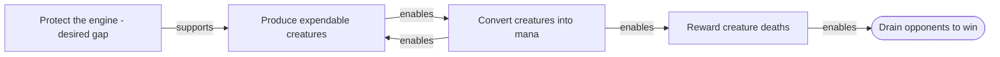

# Deck Plan graphs: Mermaid, canonical relationships and alternative formats

Investigated **2026-10-17** for [Wayfinder map, issue #71](https://github.com/OSmall/tomekin/issues/71). **Status:
research with a retention decision accepted on 17 October 2026.** This document records capability
findings and rationale; GitHub Issues remains the authority for accepted specifications and work tracking.
No dependencies or database schema changed.

**Finding:** use Mermaid as a generated inspection view. Retain the adopted relational authority. If an
existing JSON graph envelope or graph algorithms are valuable, Graphology is the closest lightweight fit;
it replaces generic graph plumbing, not Tomekin's domain contract. These are recommendations, not a
supersession of accepted planning decisions.

## Accepted conclusion — 17 October 2026

The canonical [retention decision](https://github.com/OSmall/tomekin/issues/62#issuecomment-6230776187)
is recorded on the owning issue and indexed by Wayfinder map #71.

After reviewing Mermaid, Graphology, Cytoscape.js, GraphML, Graphviz DOT and RDF/JSON-LD, and assessing
flexibility, extensibility, completeness, performance and storage efficiency, the user chose to **retain
the currently proposed Deck Plan contract for now**: versioned domain JSON at the tool boundary with
canonical relational persistence, as accepted in #62.

The representation uses conventional identified nodes and attributed relationships and fits the current
strategic-reasoning scope. Stable references and contract versioning support evolution. Its deliberate
domain restrictions and prose qualifications do not make it a general executable dependency model.
Established formats offer ecosystem interoperability and reusable graph operations, but no demonstrated
speed or storage advantage justifies replacing this contract. Runtime performance and storage size remain
unmeasured; this decision is not benchmark evidence.

The Mermaid inspection view and Graphology integration discussed below remain recommendations. This
retention decision selects no new renderer, dependency, implementation work or migration, and leaves
#73's inspection/export decisions with that ticket. Reconsideration can follow a concrete interoperability,
expressiveness or measured performance need rather than a preference for an established format alone.

## Repository and Wayfinder placement

The owning graph decision
is [#62, final resolution](https://github.com/OSmall/tomekin/issues/62#issuecomment-6193312738),
under [map #71](https://github.com/OSmall/tomekin/issues/71). It adopted a versioned JSON **tool document**,
but canonical persistence is **relational records**, explicitly without a second authoritative whole-graph
JSON column. The structured feature is planned rather than implemented. Current
[`deck-candidate.ts`](../../packages/core/src/deck-candidate.ts) requires `markdown` and selected cards;
it has no structured graph contract. The [implemented data model](../data-model.md) describes that boundary.

[#73](https://github.com/OSmall/tomekin/issues/73) owns targeted mutations and inspection/export. Its
[17 October checkpoint, Q7](https://github.com/OSmall/tomekin/issues/73#issuecomment-6230631746) accepts
complete graph JSON through an Agent Tool and developer CLI JSON/static SVG exports, with default
role/Win Route and explicit card projections. Exact interfaces and renderer remain unresolved. Thus
changing canonical graph representation would explicitly revisit #62; selecting a renderer belongs to
#73. The retention decision preserves #62's resolution. Issue #79's documentation diagrams are a
separate use of Mermaid.

The existing contract needs more than an arrow list: stable node/relationship references; role and Win
Route kinds; primary/secondary route rationale; typed directed influence; symmetric `competes_with`;
qualifications and inline evidence; card-option/role contributions; and section-aware coverage. It permits
cycles among distinct roles, rejects self-links, permits different relationship kinds between the same
endpoints, and rejects duplicate kind/source/target records. Competition is stored once per unordered
role pair. Desired unfilled roles remain meaningful. No general connectivity rule proves plan quality.

## Separate the decisions

A **graph model** defines what exists: identified nodes, identified relationships, direction, attributes,
and possibly relationships involving several participants. A **serialization** encodes that model in a
document. A **graph library** provides manipulation and algorithms. **Storage** makes records durable.
A **renderer** arranges and displays a projection. One package can serve several roles, but choosing a
renderer does not settle the other decisions.

The [domain glossary](../../GLOSSARY.md) makes Deck Plans contextual strategic claims, including Card
Contributions, conditions, support needs, and evidence. An existing format can supply graph mechanics;
it cannot supply Tomekin's meanings of `enables`, `enhances`, `supports`, or `competes_with`, or determine whether
a claimed route is strategically sound. Those meanings remain a domain contract whatever the syntax.

## What Mermaid can record

Mermaid flowcharts encode actual graph structure, not just pixels: named nodes, labelled connections,
arrow direction and subgraphs. Current Mermaid also supports explicit edge IDs, so the objection is **not** that
relationships cannot have identity. [Flowchart syntax](https://mermaid.js.org/syntax/flowchart.html).

For example, this invented role overview conveys a feedback loop and intended winning direction:

These arrows mean contextual influence, not execution order or verified card interactions. The gap node
remains visible without invented contributors. This is illustrative syntax, not an export of a saved plan.
The diagram omits card contributions, evidence and coverage details; a complete inspection needs those
in adjacent details or another projection. A subgraph is visual grouping, not a defined all-of condition.

The public `mermaid.parse()` validates syntax and returns the diagram type, rather than an application
graph document. Extraction is nevertheless possible through `mermaidAPI.getDiagramFromText()` and the
flowchart database's `getVertices()`/`getEdges()`. That is a diagram-specific integration seam, not proof
of a stable, lossless domain interchange
contract. [Public parsing API](https://mermaid.js.org/config/usage.html#syntax-validation-without-rendering),
[diagram API implementation](https://github.com/mermaid-js/mermaid/blob/develop/packages/mermaid/src/mermaidAPI.ts),
[flowchart database](https://github.com/mermaid-js/mermaid/blob/develop/packages/mermaid/src/diagrams/flowchart/flowDb.ts).

The inspected flowchart implementation parses node/edge metadata but copies selected recognized fields
into its database. For edges these include animation and curve properties; node handling includes labels,
shapes and other display fields. It does not preserve arbitrary domain attributes through that path.
The same source generates replacement edge IDs when an explicit ID collides, rather than enforcing
Tomekin's rejection policy. Thus successful diagram parsing alone is insufficient for canonical writes.
[FlowDB metadata and edge handling](https://github.com/mermaid-js/mermaid/blob/develop/packages/mermaid/src/diagrams/flowchart/flowDb.ts).

Storing the original Mermaid text verbatim could preserve comments or a metadata sidecar, but interpreting
evidence arrays, qualified relationships, reference scope and uniqueness would still require a Tomekin
convention and validator. Encoding everything in labels would instead require parsing display prose.
Either approach creates a custom schema inside diagram syntax. This is the architectural reason to prefer
a generated Mermaid view, rather than an assertion that canonical Mermaid is technically impossible.

Canonical Mermaid becomes more attractive for a deliberately small, human-authored topology whose labels
and links are the complete data. It is a poor match for this already-adopted richer contract. Preserve
semantic IDs in the domain; generate renderer-safe aliases with an explicit mapping when necessary.
If text-diagram authoring is later desired, treat it as validated import with a declared subset and
metadata policy. Do not silently write a partial inspection view back over the full plan.

Current upstream documentation was checked with Context7 and official sources. `develop` implementation
links describe the inspected upstream behavior, not a pinned production dependency. The earlier
[Pi/SVG research](./2026-10-11-pi-deck-plan-graph-display.md) separately establishes bounded Mermaid terminal
support and Graphviz SVG feasibility; latest Mermaid syntax support does not establish Pi support.

## Primary-source comparison

| Candidate                       | What it supplies                                                                                                                                                                                                                                     | Fit and cost for Tomekin                                                                                                                                                                                                                                                                                                                                                                                                                                                                                                                                                                                                                                                                                                                                                            |
|---------------------------------|------------------------------------------------------------------------------------------------------------------------------------------------------------------------------------------------------------------------------------------------------|-------------------------------------------------------------------------------------------------------------------------------------------------------------------------------------------------------------------------------------------------------------------------------------------------------------------------------------------------------------------------------------------------------------------------------------------------------------------------------------------------------------------------------------------------------------------------------------------------------------------------------------------------------------------------------------------------------------------------------------------------------------------------------------|
| **Graphology serialized graph** | Documented JSON envelope with graph/node/edge attributes; edge `key`, `source`, `target`; graph options including direction, parallel edges, and self-loops. The library provides import/export and a `MultiDirectedGraph` constructor.              | Closest lightweight reuse for an attributed directed graph in TypeScript. Domain node and relationship kinds, conditions, evidence, and versioning still belong to Tomekin. It is a library-specific format, not an independent interchange standard or database. No native multi-participant relationship in this envelope: represent a relationship as an identified node when needed. [Serialization](https://graphology.github.io/serialization.html), [constructors/options](https://graphology.github.io/instantiation.html).                                                                                                                                                                                                                                                 |
| **Cytoscape.js elements JSON**  | Nodes and edges carry JSON-serializable `data`; edges have an ID and source/target IDs. The library supports directed graphs, loops, multigraphs, and compound nodes. JSON may also carry positions and interaction state.                           | Good choice for an interactive graph viewer and a credible reusable data envelope. Persisting its entire UI state would unnecessarily bind the domain to a viewer; a data-only profile is preferable. Compound `parent` containment is a hierarchy, not overlapping package membership or a logical AND requirement. Domain validation remains separate. [Elements JSON](https://js.cytoscape.org/#notation/elements-json), [graph model](https://js.cytoscape.org/#notation/graph-model), [compound nodes](https://js.cytoscape.org/#notation/compound-nodes).                                                                                                                                                                                                                     |
| **GraphML**                     | XML interchange format with node IDs, optional edge IDs, source/target references, direction, `key`/`data` attributes, nested graphs, and hyperedges with multiple endpoints. Schema constraints include node/edge identity and endpoint references. | Strongest option here when an independent graph exchange specification is the requirement. It can encode parallel edges as separately identified edge elements; the schema does not impose source-target uniqueness or acyclicity. XML and application-specific data conventions increase authoring/adapter work. A hyperedge records participants, but Tomekin must still define their collective meaning. Consumers may ignore unsupported hyperedges/ports, so round-trip compatibility needs a declared profile. [Specification](https://graphml.graphdrawing.org/specification.html), [normative schema documentation](https://graphml.graphdrawing.org/specification/xsd.html), [identity constraints](https://graphml.graphdrawing.org/specification/element_graph.xsd.htm). |
| **Graphviz DOT**                | Text language for directed/undirected graphs with node identifiers, attribute lists, and subgraphs. Non-`strict` graphs allow parallel edges; `strict` merges repeated endpoint pairs. Attribute values and IDs are strings.                         | More than a picture language: it can record graph structure. But nested evidence/conditions require encoding conventions, edge identity needs an explicit application attribute convention, and layout/grouping instructions share the document with semantics. `A -> {B C}` expands into two binary edges; it does not mean B and C jointly satisfy a condition. Good generated export and developer inspection format. [DOT language](https://graphviz.org/doc/info/lang.html).                                                                                                                                                                                                                                                                                                   |
| **RDF + JSON-LD 1.1**           | RDF supplies directed subject-predicate-object statements with global identifiers; JSON-LD serializes linked data in JSON. RDF graphs are sets, so an identical triple cannot represent two distinct relationship instances.                         | Appropriate when cross-system vocabulary and linked-data interoperability matter. Relationship instances can instead be identified resources carrying participants, conditions, and evidence; this also handles multi-participant claims. The cost is vocabulary/context design and more indirection. JSON-LD does not eliminate a schema. SHACL can express and validate declared structural constraints, while Tomekin must still author those constraints and strategic meanings. [RDF concepts](https://www.w3.org/TR/rdf11-concepts/), [JSON-LD](https://www.w3.org/TR/json-ld11/), [n-ary relation patterns](https://www.w3.org/TR/swbp-n-aryRelations/), [SHACL](https://www.w3.org/TR/shacl/).                                                                              |
| **SQLite node/edge tables**     | Durable relational storage. Identified edge rows can reference source and target rows with foreign keys. Recursive common table expressions can traverse graph-shaped records.                                                                       | Fits the adopted repository-port/SQLite architecture. Parallel edges and cycles are possible unless additional constraints prohibit them. Composite references can keep both endpoints within one plan; membership tables can represent overlapping groups. This is a storage design, not a portable graph serialization, and remains a custom schema. SQLite foreign-key enforcement must be enabled per connection. [Foreign keys](https://sqlite.org/foreignkeys.html), [recursive CTEs](https://sqlite.org/lang_with.html#recursive_common_table_expressions), [repository ADR](../adr/0005-repository-ports-with-sqlite-mvp.md), [adapter ADR](../adr/0006-drizzle-for-sqlite-repositories.md).                                                                                |

The fit/cost judgments and proposed mappings above are architectural inferences from the cited contracts,
not claims of implemented adapters. General graph structure permits feedback cycles; a DAG-only workflow
format would need a separate justification for this domain.

## Recommendation

Retain the adopted relational authority and treat the conceptual structure as an **attributed graph
with explicitly identified relationship instances**. Keep storage, public documents, and presentation
choices independent. The question is how much generic graph machinery to reuse, not whether a Deck Plan
can have an application-specific domain schema.

If replacing the bespoke graph *envelope* is the priority, **Graphology serialization is the leading
lightweight candidate for an API/exchange or in-memory representation**. It supplies conventional keys,
endpoints, attributes, and graph options without making diagram styling authoritative. Issue #62 permits
different relationship kinds between the same endpoints, so use multi-edge support; preserve stable
explicit edge keys. Its directed influence relationships and symmetric `competes_with` relation could
use a mixed graph with undirected competition edges, or preserve the API's normalized endpoint convention
as a typed attribute. The mapping must be explicit: a graph library cannot infer symmetry from a type name.
Keep the adopted no-self-loop and per-kind endpoint uniqueness rules as domain validation. A library
should earn its dependency through useful graph operations, rather than being added solely to rename
existing arrays.

Graphology is not a drop-in full Deck Plan replacement: contributions have pair identity and candidate-owned
card references; selected membership and the pool remain their own records. A role/route graph projection
can carry nested qualifications/evidence as attributes, but its mapping, full-document envelope and runtime
validation remain application-specific. Avoid replacing one small domain document with a library document
plus a second, equally large mapping unless there is a concrete manipulation/interchange benefit.

Keep **Cytoscape.js** as a strong later viewer choice, **DOT** as an export, and **GraphML** as an optional
interchange format when a real consumer requires it. Prefer **RDF/JSON-LD** only if linked-data vocabulary,
cross-project merging, or semantic-web tooling becomes a concrete need. Retain the existing persistence
boundary: neither a graph library nor Mermaid requires introducing a graph database.

No alternative removes the need for runtime validation of node kinds, allowed endpoints, reference
scope, relationship semantics, conditions, evidence, contract versions, and domain invariants. None establishes
that a Deck Plan will win merely because the graph parses.

## Evidence boundary

This comparison used current official documentation/specifications, not package installation or runtime
experiments. Import/export preservation, rich nested attributes, stable serialization order, migrations,
Bun compatibility, actual candidate round trips, and consumer handling of optional GraphML features
were not tested. No new Mermaid runtime or renderer was installed or exercised for this investigation.
A stable byte-level canonical form would require additional ordering/normalization
rules; "canonical source of truth" here does not imply a standardized canonical byte encoding.
The GraphML primer could not be fetched directly; its official specification and schema documentation
were available and used instead. Repository source, #62's final resolution and #73's current checkpoint
were read directly; historical graph workbench proposals were not treated as current requirements.
